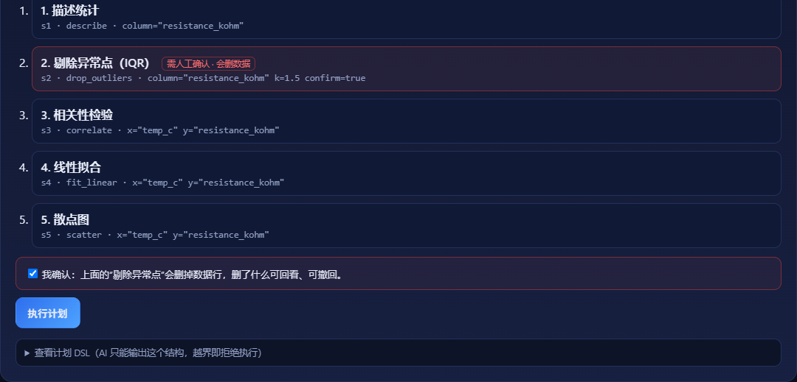
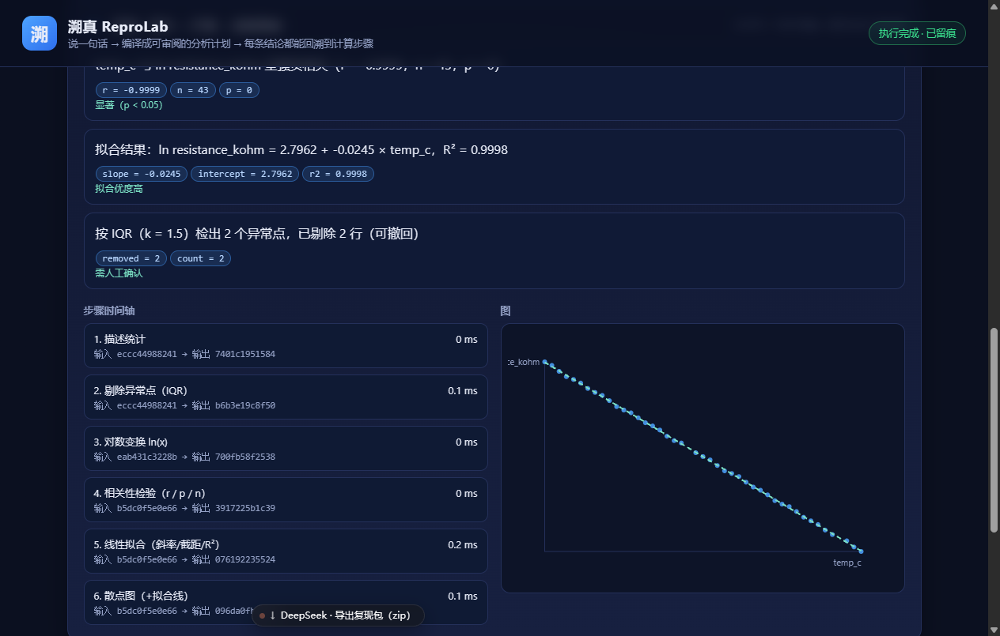
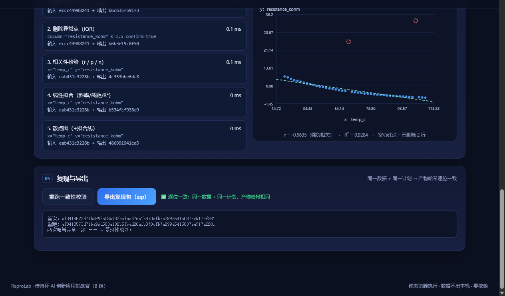
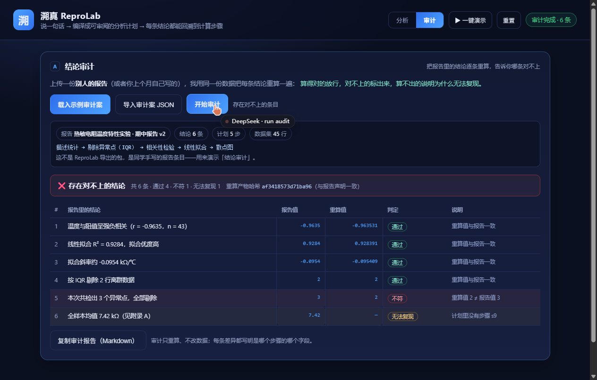

# 溯真 ReproLab

> 两种用法：**分析**——说一句话 → 编译成可审阅的分析计划 → 每条结论都能回溯到计算步骤；
> **审计**——把别人报告里的结论逐条重算，告诉你哪条对不上、哪条根本无法复现。

2026 全国高校 Vibe Coding 开发挑战赛 · 传智杯 AI 创新应用挑战赛 · B 组参赛作品

## 一句话定位

**分析模式**：上传原始实验数据，说一句你想问的问题，得到一份**结论有出处**的分析报告，以及一个**一键重跑、结果逐位一致**的复现包。

**审计模式**：上传一份**别人的报告**（或你上个月自己写的），我用同一份数据把每条结论重算一遍——算得对的放行、对不上的标红、算不出的说明为什么无法复现。这是把「可复现」从"我自己证明"变成"**我替你验**"。

## 审计模式怎么用

```bash
node serve.mjs          # 打开后点右上角「审计」
# 1) 载入示例审计案（自带一份"别人的报告"：6 条结论，其中 1 条数字被改过、1 条引用了不存在的步骤）
# 2) 点「开始审计」
# 3) 结果：4 条通过 / 1 条不符（报告写 3 个异常点，重算只有 2 个）/ 1 条无法复现（引用的步骤不存在）
```

审计案是一份 JSON，结构极简：

```json
{
  "title": "某实验报告 v2",
  "plan":  { "version": 1, "steps": [ ... ] },      // 这份报告当初用的分析计划
  "claims": [
    { "text": "温度与阻值呈强负相关（r = -0.9635）", "stepId": "s3", "field": "r", "value": -0.9635 },
    { "text": "本次共检出 3 个异常点", "stepId": "s2", "field": "count", "value": 3 }
  ],
  "expectedArtifactHash": "af341857…"              // 可选：报告声明的产物哈希
}
```

判定规则：数值允许 0.1% 相对误差（报告通常四舍五入到 4 位）；差异超过则是**不符**；步骤或字段找不到是**无法复现**；声明的产物哈希对不上，整体不通过。

## 快速开始（10 分钟复现）

```bash
# 1) 环境：只需要 Node.js ≥ 20（无 npm 依赖、无构建步骤）
node --version

# 2) 启动
node serve.mjs
# → http://127.0.0.1:5173

# 3) 浏览器打开后，两条路任选：
#    A. 点右上角「▶ 一键演示」——自动走完 数据→提问→计划→确认→执行→重跑校验，约 8 秒；
#    B. 手动：点「载入示例（热敏电阻）」→ 填问题（或点「示例问题」）→ 编译分析计划
#       → 勾选确认「剔除异常点」→ 执行 → 点结论上的数字徽章回溯步骤
#       → 「重跑一致性校验」看两次产物哈希是否一致 → 「导出复现包」拿 zip
```

零依赖：没有 `npm install`，没有构建产物，断网也能跑（LLM 可选，不配 Key 走本地规则编译）。

## 界面

| 数据接入 | 分析计划（含人工确认闸门） |
| :--: | :--: |
|  |  |

| 结论 → 步骤溯源 | 时间轴 + 散点图（红圈＝被剔除行） |
| :--: | :--: |
|  |  |

| 审计模式：报告里的结论逐条重算 | |
| :--: | :-- |
|  | 4 通过 / 1 不符 / 1 无法复现，差异写明是哪个步骤的哪个字段 |

## 核心闭环

```
原始数据（只读 + SHA-256 留痕）
   ↓
自然语言问题 → 分析计划编译（LLM 或本地规则）→ 白名单校验
   ↓
人工确认闸门（删数据/改阈值必须点确认）
   ↓
浏览器内确定性执行 → 每步留 输入哈希 / 输出哈希 / 耗时
   ↓
结论卡（每个数字绑定 step_id + 字段，缺失即拒绝渲染）
   ↓
重跑一致性校验 → 导出复现包（数据+计划+结果+报告+哈希）
```

## 三个关键设计决策

1. **AI 只能编译计划，不能写代码**：模型输出被限制为 6 个白名单算子的 JSON DSL（`describe / drop_outliers / transform_log / correlate / fit_linear / scatter`），代码由本地实现渲染 → 确定性、无代码执行风险、换模型结果不变。
2. **执行在浏览器内**：纯前端计算，数据不出本机；没有服务端执行用户代码，也就没有沙箱逃逸面。
3. **结论必须绑定统计量**：结论文本用受限模板，占位符（如 `{{r}}`）必须能在执行结果里找到真实字段，否则 `renderClaim` 直接抛错 → 从机制上杜绝“AI 编数字”。

## 目录结构

```
reprolab/
├─ index.html               # 单页工作台
├─ serve.mjs                # 零依赖静态服务器
├─ src/
│  ├─ styles.css
│  ├─ planner.js            # 自然语言 → 计划 DSL；结论卡生成与校验
│  ├─ audit.js              # 审计：逐条重算报告结论，判定 通过/不符/无法复现
│  ├─ kernel/
│  │  ├─ hash.js            # 稳定序列化 + SHA-256（浏览器/Node 同结果）
│  │  ├─ csv.js             # CSV 解析 + 列类型推断
│  │  ├─ stats.js           # 描述统计 / 相关 / 最小二乘 / p 值 / IQR
│  │  ├─ ops.js             # 6 个算子（白名单）
│  │  └─ index.js           # 计划校验 + 逐步执行 + 哈希留痕
│  ├─ export/
│  │  ├─ zip.js             # 最小 ZIP 写入器（store，无依赖）
│  │  └─ package.js         # 复现包：数据/计划/结果/报告/清单 + 自带 verify.mjs 校验脚本
│  └─ ui/app.js             # 工作台交互与渲染（含一键演示、内联提示、DSL 视图、图注）
├─ sample-data/thermal.csv  # 示例数据（含 2 个离群点）
├─ sample-data/audit-case.json # 审计演示案（6 条结论，1 条被改、1 条缺步骤）
├─ tests/kernel.test.mjs    # 19 条单测（node --test 或直接 node 运行）
├─ demo/视频分镜.md          # 5–8 分钟演示视频的分镜与口播要点
├─ docs/                    # 界面截图、技术文档、提交清单
└─ prompts/                 # AI 协同过程记录（8 轮迭代 + 4 张真界面截图）
```

## 测试

```bash
node tests/kernel.test.mjs
# 19 tests / 19 pass：解析、白名单、破坏性算子确认、可复现哈希、异常点、相关性、审计三态、
#                     结论溯源、删除清单一致性、删行后统计口径、复现包指纹可重算
```

## 可复现性怎么证明

1. 同一份 CSV + 同一个 `plan.json`，执行两次 → **产物总哈希逐位一致**（界面「重跑一致性校验」）；
2. 导出的 zip 里带 `data.csv`（含原始 SHA-256）、`plan.json`、`run.json`（每步哈希 + 删除行清单）、`report.md`、`meta.json`、`verify.mjs`；
3. **评委解压后不需要 ReproLab**，一条命令就能验：

```bash
unzip reprolab-*.zip -d reprolab-check && cd reprolab-check
node verify.mjs
# PASS  数据 SHA-256 与包内记录一致          [352e614479276cc6…]
# PASS  产物哈希可重算（执行记录未被篡改）    [af3418573d71ba96…]
# PASS  meta.json 与 run.json 的产物哈希一致
# PASS  计划只使用白名单算子
# PASS  破坏性算子已人工确认
# ✓ 全部通过：数据未改动、执行记录可重算、计划在白名单内。
```

`verify.mjs` 只依赖 Node 内置模块；改掉 `run.json` 里任何一个数字，它会立刻 FAIL 并以退出码 1 结束（实测）。

## 已知边界（MVP）

- 支持 ≤5 万行 CSV；6 个算子；单用户、单文件；
- 实测 5 万行 × 2 列：解析 22 ms / 执行 80 ms / 打包 3 ms（Node 24，本机），界面不卡；
- 不做任意代码执行、不做云端存储、不做协同编辑；
- LLM 编译为可选增强：不配 Key 也能完整演示，且规则编译结果同样可复现。
