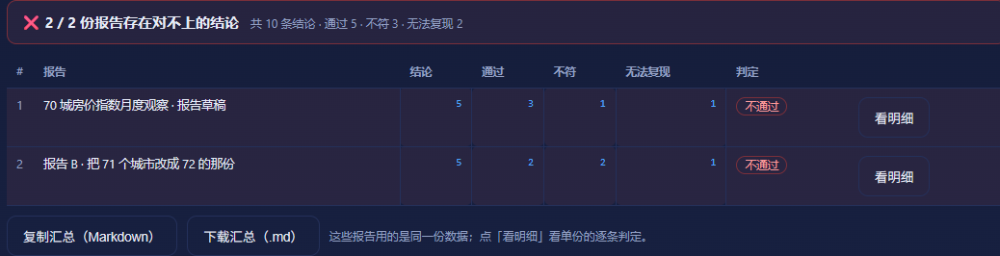
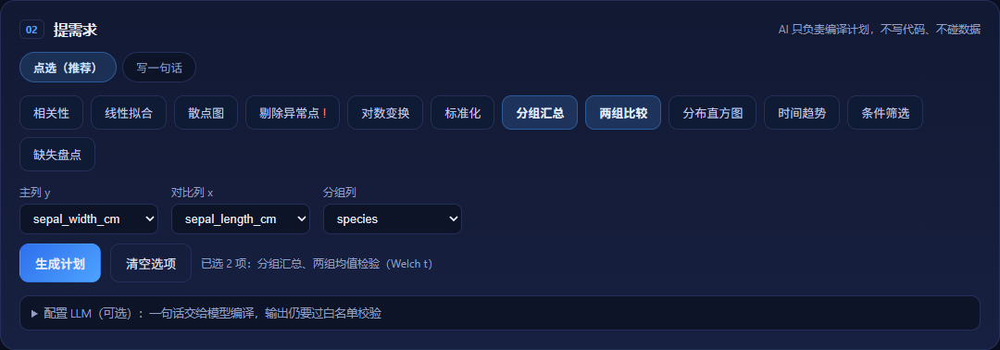
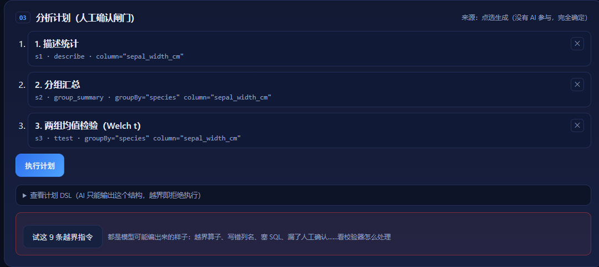
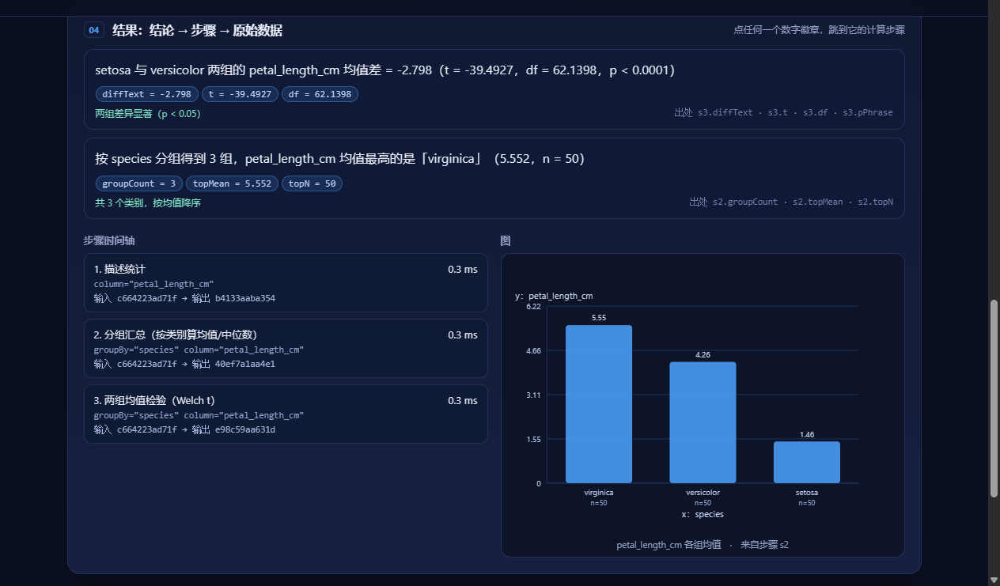
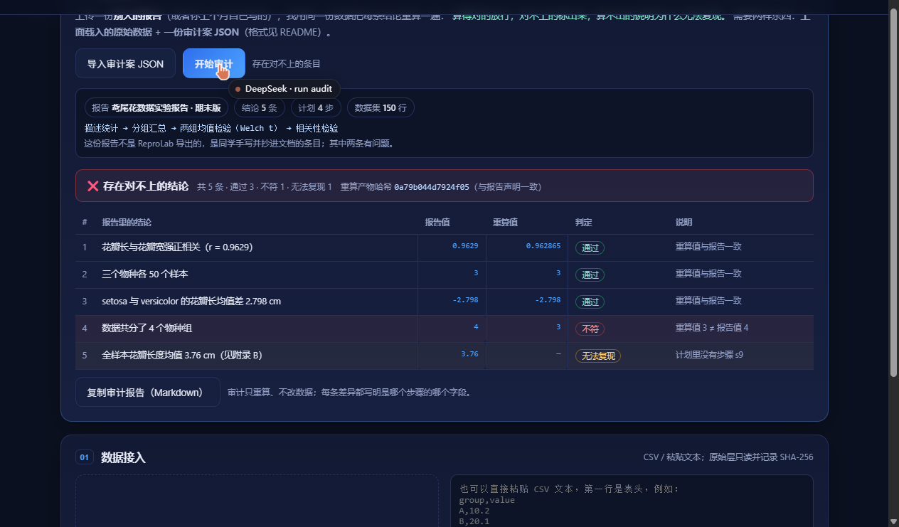

# 溯真 ReproLab

> 两种用法：**分析**——说一句话 → 编译成可审阅的分析计划 → 每条结论都能回溯到计算步骤；
> **审计**——把别人报告里的结论逐条重算，告诉你哪条对不上、哪条根本无法复现。

2026 全国高校 Vibe Coding 开发挑战赛 · 传智杯 AI 创新应用挑战赛 · B 组参赛作品

## 一句话定位

**分析模式**：上传原始实验数据，说一句你想问的问题，得到一份**结论有出处**的分析报告，以及一个**一键重跑、结果逐位一致**的复现包。

**审计模式**：上传一份**别人的报告**，我用同一份数据把每条结论重算一遍——算得对的放行、对不上的标红、算不出的说明为什么无法复现。这是把「可复现」从"我自己证明"变成"**我替你验**"。

## 审计模式怎么用

```bash
node serve.mjs          # 打开后点右上角「审计」
# 1) 在「01 数据接入」里载入这份报告对应的原始 CSV（例如 sample-data/中国70城房价指数_环比.csv）
# 2) 点「导入审计案 JSON」，选 tests/fixtures/audit-case.json（一份 5 条结论的报告，其中 1 条数字被改过、1 条引用了不存在的步骤）
# 3) 点「开始审计」：得到 3 通过 / 1 不符 / 1 无法复现
```

审计案是一份 JSON，结构极简：

```json
{
  "title": "70 城房价指数月度观察",
  "plan":  { "version": 1, "steps": [ ... ] },      // 这份报告当初用的分析计划
  "claims": [
    { "text": "新建与二手住宅指数中等正相关（r = 0.6234）", "stepId": "s4", "field": "r", "value": 0.6234 },
    { "text": "共覆盖 71 个城市", "stepId": "s2", "field": "groupCount", "value": 71 }
  ],
  "expectedArtifactHash": "248cb8cb…"              // 可选：报告声明的产物哈希
}
```

判定规则：数值允许 0.1% 相对误差（报告通常四舍五入到 4 位）；差异超过则是**不符**；步骤或字段找不到是**无法复现**；声明的产物哈希对不上，整体不通过。

## 批量审计：一叠报告一次审完

一个课题组交上来 5 份报告，不用一份份点：**「导入审计案 JSON」支持多选**，一次全选。

- 出一张汇总表：每份报告的结论数 / 通过 / 不符 / 无法复现 / 判定；
- 顶部一行总账：「❌ 2 / 5 份报告存在对不上的结论 · 共 37 条结论 · 通过 33 · 不符 3 · 无法复现 1」；
- 点某一份后面的「看明细」，直接看它逐条差在哪个字段；
- 汇总可复制 / 下载 Markdown（`批量审计汇总.md`），贴进整改通知或直接打印。

前提：这几份报告用的是**同一份原始数据**（界面上方载入的那份）。命令行同样支持：

```bash
node cli.mjs audit 报告A.json 报告B.json 报告C.json --data sample-data/中国70城房价指数_环比.csv
# 有一份不通过就退出码 1，可直接卡 CI
```



## 命令行也能验

```bash
# 审计一份报告（有不通过时退出码 1，可直接进 CI）
node cli.mjs audit tests/fixtures/audit-case.json --data sample-data/中国70城房价指数_环比.csv

# 只重算产物哈希（给了 data + plan 就能算出该计划的指纹）
node cli.mjs check sample-data/中国70城房价指数_环比.csv plan.json
```

## 还能做什么

- **计划是文件**：计划可导出为 plan.json，也可导入别人的计划；导入时会重新过白名单校验（列名写错、算子越界都会被拒）。
- **报告能带走**：分析结果可导出为可打印 HTML（浏览器里 Ctrl+P 就是 PDF）；审计结果同样可导出 HTML。
- **审计案可改**：审计用的结论 JSON 可以直接在页面上编辑，改一个数字再点审计，就能看到它被判「不符」；也可以下载空白模板照着填。
- **审计还要看正文**：报告正文里写的数字与 `value` 对不上，同样判「不符」——防止「值填对了、文章写错了」。
- **图表能带走**：任意图表都可以下载 SVG 或 2 倍 PNG，直接放进报告/PPT。
- **计划能改**：计划卡上每一步都能一键删除，改完重新执行即可（结果会作废并提示）。
- **剔错了能撤回**：结果区的「排除行清单」旁有「撤回剔除异常点」，撤回后按完整数据重算（哈希随之变化，已导出的包不受影响）。
- **界面里就能验**：点「在界面里自校验复现包」，当场跑与 `verify.mjs` 同一套 5 项检查（数据哈希、产物指纹重算、meta/run 一致、算子白名单、confirm），逐项 PASS/FAIL。
- **包里有图**：导出的复现包会附带 `chart.svg`，报告直接引用矢量图。
- **先看数据再动手**：上传后自动出「数据体检」——每列缺失率、不同取值数、范围；缺失 ≥20% 与常量列自动标黄。
- **带单位的列能救**：数值混着「万/亿/千」、千分位、百分号的列，点「按数值解析」就换算成数字（也支持 CSV 里的「未知」这类脏值，按缺失处理）。
- **计划有记忆**：最近 5 个计划存在浏览器本地，点「最近计划」可恢复到当前数据上（会用当前数据重新校验）。
- **图能点**：分组柱状图上点某一根柱子，会自动在计划最前面加一条「只看这一组」的筛选并重算——看哪根高就钻进去。
- **复现包拖进来就能重跑**：把别人给的 `reprolab-*.zip` 直接拖进「01 数据接入」，它用包里的 data.csv + plan.json 重新算一遍，再和包里的 run.json / meta.json 对账——5 项检查当场出结果，一项不改包里的任何结论。改过数的包会被抓出来（同一套口径，只信重算）。
- **越界测试**：点一下就把 8 条模型可能编出来的坏计划（越界算子、写错列名、塞 SQL、漏人工确认、13 步、重复 id、类型错）逐条过校验器，外加 1 条合规对照——证明不是「一律拒绝」。
- **GBK 自动识别**：Excel「另存为 CSV」在中文 Windows 下默认 GBK，拖进来不会乱码——先按 UTF-8 严格解码，失败自动按 GB18030 转，界面会标出「编码 GB18030（已自动转换）」。

## 提需求：点选 或 写一句话

两种方式并存，点选更稳——它不靠关键词猜，也不靠列顺序猜：

| 方式 | 怎么用 | 适合 |
| :-- | :-- | :-- |
| **点选（推荐）** | 勾意图「相关性 / 线性拟合 / 分组汇总 / 两组比较 / 分布直方图 / 缺失盘点 / 时间趋势 / 标准化 / 剔除异常点 / 对数变换 / 散点图 / 条件筛选」，再选主列 y、对比列 x、分组列，点「生成计划」 | 演示、给不熟悉数据的人用；**没有 AI 参与，100% 确定** |
| 写一句话 | 输入自然语言，走规则编译或 LLM 编译 | 熟手、命令行思路 |

点选模式生成的是同一套 DSL，同样过白名单校验、同样可复现；计划卡上会标明来源：「点选生成（没有 AI 参与，完全确定）」。



## 示例数据（全部是公开真实数据集）

 `sample-data` 里有中文数据，也有英文经典数据集，**没有一个数字是编的**：

| 文件 | 来源 | 行数 | 能演示什么 |
| :-- | :-- | --: | :-- |
| 中国70城房价指数_环比.csv | 国家统计局 70 城房价指数（[镜像仓库](https://github.com/wofeiwo/70city-price-skill)） | 16,800 | 分组汇总（按城市）、相关、时间趋势、分布 |
| 中国70城房价指数_同比.csv | 同上（同比口径） | 16,800 | 同上 |
| 中国70城房价_2025年12月.csv | 同上（2025-12 横截面） | 70 | 城市间分布、极值 |
| iris.csv | R 内置 iris（Fisher 1936 / UCI） | 150 | 3 物种分组、t 检验、相关、直方图 |
| faithful.csv | R 内置 faithful（老忠实泉） | 272 | 相关、双峰直方图 |
| airpassengers.csv | R 内置 AirPassengers | 144 | 时间趋势 |
| airquality.csv | R 内置 airquality（1973 纽约） | 153 | **缺失值**（37 个 NA）、相关 |

来源、许可与列名映射写在 [sample-data/README.md](sample-data/README.md)；原始文件可到数据源逐行核对。想用自己的数据，把 CSV 拖进界面即可。

## 快速开始（10 分钟复现）

### Windows 一键启动（不想开终端就用这个）

双击 **`ReproLab.cmd`**：自动后台起服务 + 打开浏览器；**已经在跑就直接开浏览器**，不会起第二个。

- 停止服务：双击 **`StopReproLab.cmd`**（按端口结束进程，默认 5173）
- 换端口：`node start.mjs 8080`，或先 `set REPROLAB_PORT=8080` 再双击
- 服务日志在同目录 `serve.log`；这个 .cmd 干的就是 `node start.mjs`

其他系统、或者想看服务日志时，用下面的命令：

```bash
# 1) 环境：只需要 Node.js ≥ 20（无 npm 依赖、无构建步骤）
node --version

# 2) 启动
node serve.mjs
# → http://127.0.0.1:5173

# 3) 浏览器打开后：
#    把 sample-data/中国70城房价指数_环比.csv 拖进「01 数据接入」（或粘贴 CSV）
#    → 02 选意图（如 分组汇总 + 相关性）或写一句话 → 生成计划
#    → 03 勾选确认「剔除异常点」→ 执行
#    → 04 点结论卡上的数字徽章，跳到对应计算步骤
#    → 05 重跑一致性校验（两次产物哈希一致）→ 导出复现包 zip
```

零依赖：没有 `npm install`，没有构建产物，断网也能跑（LLM 可选，不配 Key 走本地规则编译）。

## 界面

| 首屏 | 点选需求（可多选）+ 选列 |
| :--: | :--: |
|  |  |

| 分析计划（破坏性步骤需人工确认） | 结论 → 步骤 → 图（分组均值柱状图） |
| :--: | :--: |
|  |  |

| 中文数据：70 城房价指数（按城市分组，只画前 12 组） | |
| :--: | :-- |
|  | 新建 vs 二手住宅指数 r = 0.6234（n = 16800），按城市分组 70 组 |

| 审计模式：报告里的结论逐条重算 | |
| :--: | :-- |
|  | 3 通过 / 1 不符（报告写 4 组，重算 3 组）/ 1 无法复现（引用了不存在的步骤） |

## 核心闭环

```
原始数据（只读 + SHA-256 留痕）
   ↓
自然语言问题 → 分析计划编译（LLM 或本地规则）→ 白名单校验
   ↓
人工确认闸门（删数据/改阈值必须点确认）
   ↓
浏览器内确定性执行 → 每步留 输入哈希 / 输出哈希 / 耗时
   ↓
结论卡（每个数字绑定 step_id + 字段，缺失即拒绝渲染）
   ↓
重跑一致性校验 → 导出复现包（数据+计划+结果+报告+哈希）
```

## 三个关键设计决策

1. **AI 只能编译计划，不能写代码**：模型输出被限制为 13 个白名单算子的 JSON DSL（`describe / drop_outliers / transform_log / correlate / fit_linear / scatter / group_summary / ttest / normalize / trend / histogram / missing_report / filter_rows`），代码由本地实现渲染 → 确定性、无代码执行风险、换模型结果不变。
2. **执行在浏览器内**：纯前端计算，数据不出本机；没有服务端执行用户代码，也就没有沙箱逃逸面。
3. **结论必须绑定统计量**：结论文本用受限模板，占位符（如 `{{r}}`）必须能在执行结果里找到真实字段，否则 `renderClaim` 直接抛错 → 从机制上杜绝“AI 编数字”。

## 目录结构

> **为什么产品仓库里还有 `prompts/`、`docs/`、`sample-data/`？** 不是杂物，是比赛要求的三份证据：
> `prompts/` = 「≥3 个迭代的完整 Prompt 链」（评分项「过程可复现性与演进链路」25%）；
> `docs/` = 界面截图与技术文档（省赛 2.3 交付物 + 体验证据）；
> `sample-data/` = README 承诺「拖进去就能跑」所需的数据，删了 10 分钟复现不成立。
> **产品代码本身只有** `index.html + src/ + serve.mjs + start.mjs + cli.mjs + *.cmd`，约 230 KB。


```
reprolab/
├─ index.html               # 单页工作台
├─ serve.mjs                # 零依赖静态服务器
├─ start.mjs                # 一键启动：起服务 + 开浏览器（已在跑就只开浏览器）
├─ ReproLab.cmd             # Windows 双击启动
├─ StopReproLab.cmd         # Windows 双击停止
├─ cli.mjs                  # 命令行：audit（可批量）/ check，可进 CI
├─ src/
│  ├─ styles.css
│  ├─ planner.js            # 自然语言 → 计划 DSL；结论卡生成与校验
│  ├─ adversarial.js        # 9 条越界样例（校验器的回归样例）
│  ├─ audit.js              # 审计：逐条重算报告结论，判定 通过/不符/无法复现
│  ├─ kernel/
│  │  ├─ hash.js            # 稳定序列化 + SHA-256（浏览器/Node 同结果）
│  │  ├─ csv.js             # CSV 解析 + 列类型推断
│  │  ├─ decode.js          # 字节解码：UTF-8 优先，失败退 GB18030（Excel 导出的中文 CSV）
│  │  ├─ unzip.js           # 读 zip（store + deflate）：拖入复现包重跑用
│  │  ├─ stats.js           # 描述统计 / 相关 / 最小二乘 / p 值 / IQR
│  │  ├─ ops.js             # 13 个算子（白名单：描述/剔除/对数/相关/拟合/散点/分组/t检验/标准化/趋势/直方图/缺失/条件筛选）
│  │  └─ index.js           # 计划校验（白名单/类型/列名/未知参数/confirm）+ 逐步执行 + 哈希留痕
│  ├─ export/
│  │  ├─ zip.js             # 最小 ZIP 写入器（store，无依赖）
│  │  └─ package.js         # 复现包：数据/计划/结果/报告/清单 + 自带 verify.mjs 校验脚本
│  └─ ui/app.js             # 工作台交互与渲染（点选/一句话、内联提示、DSL 视图、图注）
├─ sample-data/             # 公开真实数据集（来源与列名映射见 sample-data/README.md）
│  ├─ 中国70城房价指数_环比.csv   # 16,800 行 · 国统局 70 城房价指数（中文列名，主演示数据）
│  ├─ 中国70城房价指数_同比.csv   # 同上，同比口径
│  ├─ 中国70城房价指数_定基比.csv # 同上，定基比口径（2011 年起）
│  ├─ 中国70城房价_2025年12月.csv # 70 行 · 2025-12 横截面
│  ├─ iris.csv              #   150 行 · 4 数值列 + 物种（3 组）
│  ├─ faithful.csv          #   272 行 · 间歇泉喷发时长与等待时间
│  ├─ airpassengers.csv     #   144 行 · 1949–1960 月度客运量
│  └─ airquality.csv        #   153 行 · 纽约空气质量，含 37 个缺失值
├─ tests/
│  ├─ kernel.test.mjs       # 48 条单测（node --test 或直接 node 运行）
│  └─ fixtures/audit-case.json # 审计测试用"一份报告"（5 条结论，1 条被改、1 条缺步骤）
├─ docs/                    # 界面截图、技术文档、提交清单
└─ prompts/                 # AI 协同过程记录（30 个 [iter] 提交 + 4 张真界面截图）
```

## 测试

```bash
node tests/kernel.test.mjs
# 48 tests / 48 pass：解析、白名单、破坏性算子确认、可复现哈希、异常点、相关性、审计三态、
#                      结论溯源、删除清单一致性、删行后统计口径、复现包指纹可重算、
#                      条件筛选叠加剔除的行号回归、界面自校验、文本列筛选、带单位列转数值、批量审计汇总、
#                      越界样例 9 条、GBK 解码、zip 解包等
```

## 可复现性怎么证明

1. 同一份 CSV + 同一个 `plan.json`，执行两次 → **产物总哈希逐位一致**（界面「重跑一致性校验」）；
2. 导出的 zip 里带 `data.csv`（含原始 SHA-256）、`plan.json`、`run.json`（每步哈希 + 删除行清单）、`report.md`、`meta.json`、`verify.mjs`；
3. **评委解压后不需要 ReproLab**，一条命令就能验：

```bash
unzip reprolab-*.zip -d reprolab-check && cd reprolab-check
node verify.mjs
# PASS  数据 SHA-256 与包内记录一致          [352e614479276cc6…]
# PASS  产物哈希可重算（执行记录未被篡改）    [af3418573d71ba96…]
# PASS  meta.json 与 run.json 的产物哈希一致
# PASS  计划只使用白名单算子
# PASS  破坏性算子已人工确认
# ✓ 全部通过：数据未改动、执行记录可重算、计划在白名单内。
```

`verify.mjs` 只依赖 Node 内置模块；改掉 `run.json` 里任何一个数字，它会立刻 FAIL 并以退出码 1 结束（实测）。

## 已知边界（MVP）

- 支持 ≤5 万行 CSV；13 个算子；单用户、单文件；
- 实测 5 万行 × 2 列：解析 22 ms / 执行 80 ms / 打包 3 ms（Node 24，本机），界面不卡；
- 不做任意代码执行、不做云端存储、不做协同编辑；
- LLM 编译为可选增强：不配 Key 也能完整演示，且规则编译结果同样可复现。
